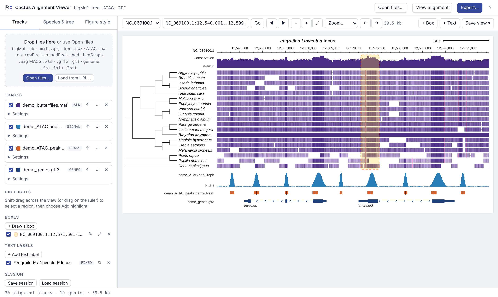
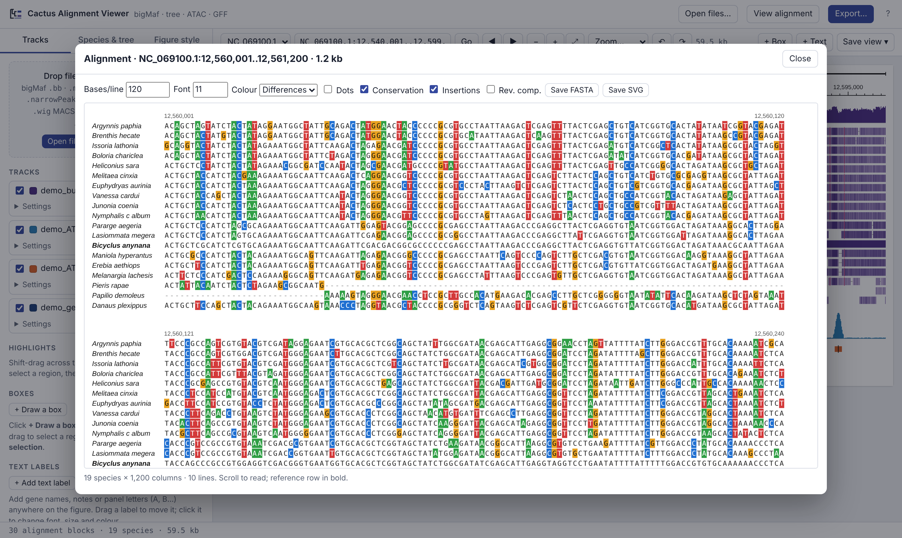

# Cactus Alignment Viewer

A browser-based viewer for **Cactus whole-genome alignments** (bigMaf / MAF) drawn alongside the **species phylogeny**, **ATAC-seq** signal and peaks, **BED** regions and **GFF3/GTF** gene models. It is built for making **publication figures**: everything on screen can be restyled, annotated and exported as editable SVG or high-resolution PNG/JPEG.

It is a single HTML file. There is nothing to install, no server and no upload: files are read directly from your computer, so multi-gigabyte bigMaf and bigWig files open quickly.

## Download and run on your computer

**[⬇ Download CactusAlignmentViewer.html](https://github.com/msuriyan/cactus-alignment-viewer/releases/latest/download/CactusAlignmentViewer.html)** (latest release, about 220 KB)

1. Click the link above and save the file anywhere (for example your Desktop).
2. Double-click `CactusAlignmentViewer.html`. It opens in your web browser (Chrome, Edge, Firefox or Safari).
3. Drag your files onto the page.

That's all: no installation, no Python, no server, no internet connection needed, and your data never leaves your computer. To update, download the file again.

Other ways to get it:
- **Try it online first:** https://msuriyan.github.io/cactus-alignment-viewer/ (the page has a **Download app** button that saves the same file)
- **All versions:** the [Releases page](https://github.com/msuriyan/cactus-alignment-viewer/releases)
- **Command line:** `curl -L -o CactusAlignmentViewer.html https://github.com/msuriyan/cactus-alignment-viewer/releases/latest/download/CactusAlignmentViewer.html`
- On a shared machine or HPC login node you can keep the file next to your data, but it needs a desktop browser to run; copy the data files (or use the **Load from URL** option with a web server that supports range requests).

> If your browser shows the file as text instead of opening it, right-click the download link and choose **Save link as…**, or use the Releases page.



## Features

**Data**
- bigMaf (`.bb`) with random access from disk, and text MAF (`.maf`, `.maf.gz`)
- Newick trees (`.nwk`, `.newick`, `.tre`, …) to order rows and draw the phylogeny (cladogram or phylogram)
- ATAC signal: bigWig (`.bw`), bedGraph, WIG
- Peaks and regions: narrowPeak, broadPeak, gappedPeak, BED/BED12, bigBed, MACS2 `_peaks.xls`
- Annotation: GFF3, GTF (also `.gz`)
- Reference genome: FASTA with `.fai`, plain FASTA, `.2bit`
- Any number of tracks, in any order

**Browsing** (similar to IGV / JBrowse / UCSC)
- Drag to pan, double-click or Ctrl/⌘+scroll to zoom, zoom presets, whole-chromosome view
- Back / forward through previous views; jump to a gene name or `chrom:start..end`
- Shift-drag to select a region, then zoom, view bases, export, highlight or annotate it
- Base-level alignment viewer for any selected region

**Display options**
- Alignment coloured by identity to the reference, by mismatches, or by base (A/C/G/T)
- Gaps (deletions) and insertions relative to the reference are marked
- Conservation plot, weighted by the phylogeny or equally per species
- Feature tracks: expanded / squished / collapsed; signal: area / line / heatmap, autoscale, fixed maximum or log scale
- Genes: all isoforms or the longest isoform per gene; label by gene name, transcript name or ID, or hide individual labels

**Focusing on ATAC peaks (or any BED regions)**
- Restrict the alignment and conservation plot to peaks from any peak/BED track, with optional padding; regions outside are hidden or faded
- Step through peaks with **◂ Prev / Next ▸** (or the P / N keys)
- **Peak analysis** table for every peak: length, ATAC signal, conservation %, identity % and number of species aligned; sortable, click to jump, save as TSV
- Export the peak alignments as multi-FASTA, MAF, or a **concatenated supermatrix with a partition file** (RAxML / IQ-TREE) or NEXUS charsets, ready for phylogenetic analysis
- **Multi-peak figure**: selected peaks side by side in one figure, sharing the tree and a common signal scale (SVG / PNG / JPEG)

**Editing for figures**
- Reorder tracks by dragging; rename tracks; show or hide each track name
- Rename and recolour species; rotate tree nodes, ladderize, colour clades, hide species
- Size, colour and weight for every text element (title, species names, chromosome, ruler, scale bar, track names, gene names, axis values) plus a single "scale all text" control
- Free text labels with any font, size and colour, `*italic*` gene names, optional background and border; pinned to a genome position or fixed on the figure
- Boxes of any size with fill colour, transparency %, optional border (colour, width, dashed), rounded corners, above or behind the data
- Highlight bands; editable annotation features exported as GFF3/BED
- Sessions save tracks, styles, tree edits, labels, boxes and annotations

**Export**
- Figure as **SVG** (vector, grouped by track for Illustrator / Inkscape), **PNG** or **JPEG** at 150–1200 DPI with the DPI written into the file
- Any region and any print width (mm), not just what is on screen
- Wrapped base-level alignment figure (Clustal-style), SVG or PNG
- Alignment sequences of any length as FASTA, Clustal, PHYLIP, NEXUS or MAF, with optional reverse complement



## Quick start

1. Double-click `CactusAlignmentViewer.html` (or open the online copy).
2. Drag your files onto the page: the bigMaf `.bb`, the tree `.nwk`, ATAC `.bw` and peak files, `.gff3`, and the genome `.fa` together with its `.fai`.
3. Type a gene name or location in the box at the top, or click **Try the demo data** to explore first.
4. Use **Export…** or **Save view** to save the figure.

### Making a bigMaf from a Cactus HAL

```bash
# 1. MAF referenced on your genome of interest
hal2maf alignment.hal alignment.maf --refGenome Bicyclus_anynana --onlyOrthologs --noAncestors

# 2. Convert to bigMaf (UCSC tools: mafToBigMaf, bedToBigBed; bigMaf.as from the UCSC source tree)
mafToBigMaf Bicyclus_anynana alignment.maf stdout | sort -k1,1 -k2,2n > alignment.bigMaf.txt
bedToBigBed -type=bed3+1 -as=bigMaf.as -tab alignment.bigMaf.txt chrom.sizes alignment.bigMaf.bb
```

Tree leaf names should match the genome names used in the HAL (e.g. leaf `Bicyclus_anynana` for MAF rows named `Bicyclus_anynana.NC_069100.1`). Names that don't match can be paired with tree leaves in the **Species & tree** panel.

### A note on the conservation plot

The built-in plot shows sequence **identity** to the reference, averaged across species (by default weighted by the tree's branch lengths, so a clade of many close relatives doesn't dominate). Identity is high both where sequence is constrained by selection and where species simply diverged recently. For a statistical measure of constraint, compute **phyloP** or **phastCons** (e.g. `halPhyloP` from HAL tools) and load the resulting bigWig as a signal track.

## Browser support

Recent Chrome, Edge, Firefox and Safari. Very large raster exports are limited by the browser's maximum canvas size; SVG export has no size limit.

## For maintainers: publishing

**Download file (Releases).** Pushing to `main` publishes or refreshes the release named after `version:` in `CITATION.cff`, with `CactusAlignmentViewer.html` attached (see `.github/workflows/release.yml`). To release a new version, update `index.html`, raise the version in `CITATION.cff` (e.g. `1.1.0`), and push. The README download link always points to the newest release.

**Online copy (GitHub Pages, optional).** **Settings → Pages → Source: Deploy from a branch**, branch `main`, folder `/ (root)`. The viewer is then live at `https://msuriyan.github.io/cactus-alignment-viewer/`. Data opened there still stays on the user's computer; GitHub only serves the HTML file.

## Tests

```bash
pip install playwright pybigtools pyBigWig
python -m playwright install chromium
python tests/make_test_data.py   # synthetic bigMaf, MAF, bigWig, bigBed, FASTA, GFF3 with known answers
python tests/run_tests.py        # checks the readers against ground truth in headless Chromium
```

## Citation

If you use this tool in a publication, please cite it using the metadata in [`CITATION.cff`](CITATION.cff) (GitHub shows a "Cite this repository" button).

## License

[MIT](LICENSE)
